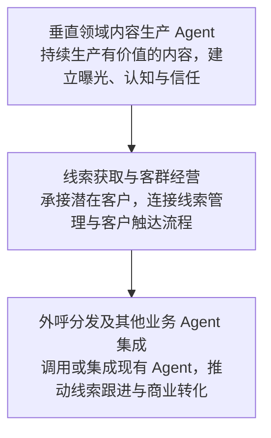

## Flowbeast-Agent｜AI Agent 应用实践

重要提醒:该项目虽可demo,但还不完善,简历和个人网站中如果提及,可作为一个钩子或概述,不能过度夸大(除非我更新了相关文档表明有更大新的进展)

> AI Agent · Growth Operations · Business Automation

项目定位：面向业务增长与商业转化场景的 AI Agent 应用与编排项目。

以垂直领域的内容生产为入口，通过调用、集成不同的业务 Agent，将内容触达、潜在客户获取与后续客户经营连接起来，探索 AI 如何帮助企业提高增长效率与商业转化能力。

项目的核心逻辑

> **说明：** 上述流程图是根据已保存的方向性记忆整理的概念模型，不代表已完成的产品功能。

## 二、项目直接相关的几个关键点

| 维度         | 记忆中的定位                                         |
| ---------- | ---------------------------------------------- |
| 项目性质       | AI Agent 应用、调用与多 Agent 编排 / 集成                 |
| 业务切入点      | 垂直领域内容生产与增长运营                                  |
| 核心业务链路     | 内容触达 → 建立认知与信任 → 获取线索 → 客群经营 → 外呼分发与转化         |
| 技术策略       | 不追求所有能力都自己开发；对于线索经营、外呼分发等能力，优先考虑调用或集成现有 Agent  |
| 商业价值       | 将 AI 能力应用于真实业务流程，帮助企业提高运营效率和线索转化能力             |
| 长期方向       | 出海增长运营、海外用户增长、AI 产品运营，以及 Agent 开发和多 Agent 编排   |
| 项目与个人发展的关系 | 既是探索未来创业与商业化的载体，也是积累 Agent 应用、业务理解和增长运营能力的实践项目 |

其中有一个很重要的区别：并不是想把自己定位成一个单纯的 Agent 开发者。

你真正感兴趣的是：理解业务如何获得客户、经营客户、实现收入，再利用 AI Agent 把其中可以自动化、标准化的环节连接起来。

这与我之前认可的方向一致：把技术能力沉降到真实业务场景中，理解商业逻辑和财务账本，并最终对商业交付结果负责。

## 三、Flowbeast 与你的职业方向是什么关系？

我记忆中的职业规划是分成两个层次的。

第一层：现实职业入口

出海增长运营（AI Agent 方向）、海外用户增长（AI 应用方向）、AI 产品运营（Agent 方向）。

先进入真实业务环境，积累用户增长、产品运营、商业化和 AI 应用落地经验。

第二层：长期能力与商业化方向

Agent 开发、多 Agent 编排与集成，以及将这些能力应用于垂直领域的增长和客户经营场景。

Flowbeast 是你探索这条路线的项目载体，而不是要求你现在就必须把它做成完整商业产品。

* 基于 Qwen、DeepSeek 等模型开展 AI Agent 应用实践，运用 Prompt、Skills、MCP 组织任务流程、集成工具调用，探索复杂任务的自动化执行。
* 使用 **Claude Code** 辅助开发与调试，围绕实际任务验证输出结果并迭代实现；项目 Demo 已上线。
