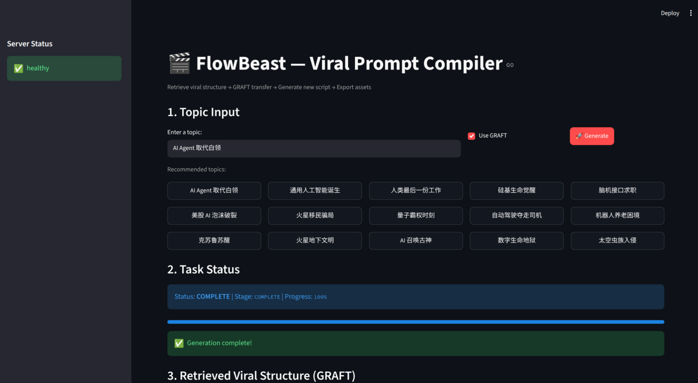
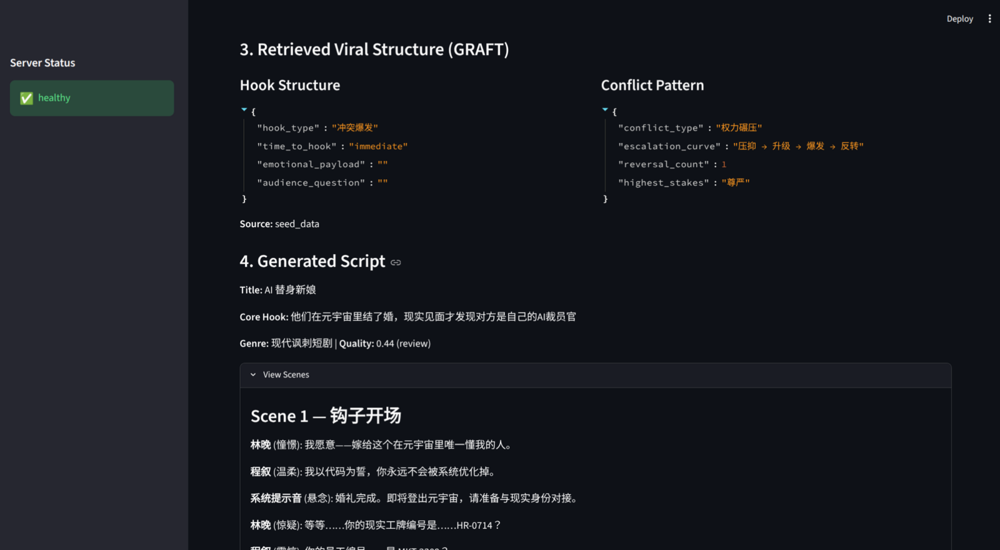
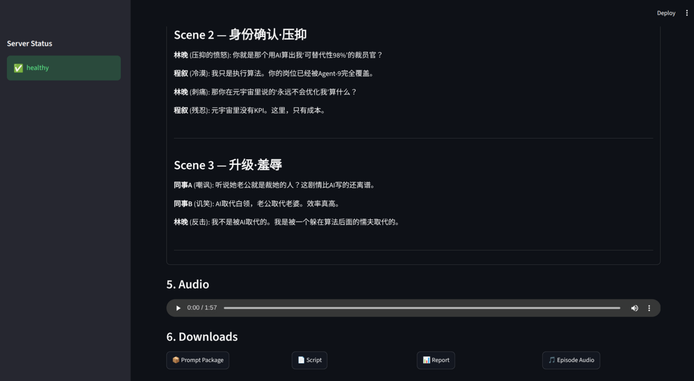

<div align="center">

# 🌊 FlowBeast

**输入一个话题,输出一整套可直接喂给 AI 视频工具的爆款 Prompt 包。**

`topic → FP3 检索 → GRAFT 变换 → 脚本 → 分镜 → 配音 → prompt_package.json`

[](https://www.python.org/)
[](https://docs.astral.sh/uv/)
[](#测试)
[](#项目状态)
[](https://fastapi.tiangolo.com/)
[](https://streamlit.io/)

</div>

---

## 目录

- [这是什么](#这是什么)
- [为什么需要它](#为什么需要它)
- [界面预览](#界面预览)
- [快速开始](#快速开始)
- [入口点与命令](#入口点与命令)
- [你会得到什么](#你会得到什么)
- [架构](#架构)
- [核心概念](#核心概念)
- [技术栈](#技术栈)
- [配置](#配置)
- [测试](#测试)
- [项目状态](#项目状态)
- [故障排查](#故障排查)
- [目录结构](#目录结构)
- [相关文档](#相关文档)

---

## 这是什么

FlowBeast 是一个**爆款 Prompt 编译器 (Viral Prompt Compiler)**。

你给它一个话题(比如 "AI Agent 取代白领"),它返回一个 `prompt_package.json` —— 里面包含经过结构校验的剧本、逐镜头的运镜/景别/情绪/光照指令、以及锁定好的视觉风格。这个包可以直接投喂给 Seedance、Kling(可灵)、HeyGen 这类 AI 视频工具。

**它不是**:又一个 "调 GPT 写文案" 的壳。
**它是**:一套把"已经爆过的内容"反向拆解成可复用结构、再重组到新话题上的工程系统。

```
传统做法:  话题 ──► LLM ──► 一段文本           (结构随机,不可复用,无质量校验)
FlowBeast: 话题 ──► 检索爆款结构 ──► 算子变换 ──► 质量门禁 ──► prompt_package.json
                    (FP3 记忆)      (VTO)        (QualityGate)
```

---

## 为什么需要它

大模型会越来越强,视频工具会越来越便宜。**但"什么样的内容结构容易爆"这件事,不会随模型升级自动出现。**

FlowBeast 押注的护城河不是生产管线(script → audio → video,那是可替换的商品层),而是:

> **爆款内容的可组合结构 —— 一套"隐式语法" (Latent Grammar)**

它编译的不是代码,而是:**情绪 · 冲突 · 镜头 · 节奏 · 爽点 · 人设 · 视觉风格 · 音频情绪**。

系统不检索并复制整部剧本,而是检索**兼容的叙事原子**,按语法规则组合,经 VTO 算子变换,生成"结构新颖但携带爆款 DNA"的新剧本。

---

## 界面预览

### 🎬 30 秒演示

> **【GIF 占位 —— 待替换】**
> 把剪辑好的演示录屏导出为 GIF,放到 `assets/screenshots/demo.gif`,
> 然后删掉本段提示,并取消下面这行注释即可。
>
> <!--  -->

**这 30 秒里会发生什么:**

| 时间 | 画面 | 说明 |
|------|------|------|
| `0:00–0:05` | 服务状态 `✅ healthy` | 后端已连上,FP3 向量库就绪 |
| `0:05–0:10` | 从推荐话题里点选一个 | 一键填充输入框(15 个预置话题) |
| `0:10–0:15` | 点击 **🚀 Generate** | 任务提交,拿到 `task_id`,开始轮询 |
| `0:15–0:22` | 进度条推进(此处剪辑跳帧) | `GRAFT_RETRIEVAL → GRAFT_APPLIED → GENERATION → SHOT_DIRECTION → AUDIO → EXPORT` |
| `0:22–0:26` | **Retrieved Viral Structure** | 展示检索到的 hook 结构与冲突模式 —— 这是 GRAFT 在起作用 |
| `0:26–0:30` | 生成剧本 + 音频播放器 + 4 个下载按钮 | 端到端产物交付 |

### 完整流程(静态截图)

以下三张是同一次运行的连续滚动,展示了从输入到产物的完整链路。

**① 输入话题 → 生成完成**



选一个推荐话题(此例为 `AI Agent 取代白领`),勾选 `Use GRAFT`,点击 Generate。任务在后台异步执行,进度条走到 `COMPLETE 100%`。

**② 检索到的爆款结构 → 生成的剧本**



左侧是 GRAFT 从 FP3 检索出的**开场结构**(`hook_type: 冲突爆发`、`time_to_hook: immediate`),
右侧是**冲突模式**(`conflict_type: 权力碾压`、`escalation_curve: 压抑 → 升级 → 爆发 → 反转`、`highest_stakes: 尊严`)。
下方是据此生成的新剧本 —— 注意 `Title` / `Core Hook` / 场景台词已经换成了全新话题,但**冲突升级的骨架与检索到的结构一致**。

**③ 分场剧本 → 配音 → 产物下载**



音频由 Edge TTS 逐句生成后拼接(此例 1:57),4 个下载按钮分别导出 `prompt_package.json`、`script.json`、`production_report.json`、`episode_audio.mp3`。

> ⚠️ 截图中 `Quality: 0.44 (review)` 低于 0.60 的接受阈值,且 `Source: seed_data` ——
> 这是**当前语料库只有演示数据**的直接体现,不是渲染错误。参见 [项目状态](#项目状态)。

---

## 快速开始

### 前置要求

| 依赖 | 版本 | 用途 | 是否必需 |
|------|------|------|----------|
| **Python** | ≥ 3.12 | 运行时 | ✅ 必需 |
| **[uv](https://docs.astral.sh/uv/)** | 最新 | 包管理(本项目不用 pip) | ✅ 必需 |
| **LLM API Key** | — | DeepSeek / OpenAI / Qwen 任选其一 | ✅ 必需 |
| **[Ollama](https://ollama.com/)** | 最新 | 本地 embedding(`nomic-embed-text`) | ✅ 必需¹ |
| Docker | — | 容器化运行 | ⬜ 可选 |

> ¹ Embedding 走本地 Ollama,**不需要 API Key、不产生费用**。这是因为 DeepSeek 等主流厂商不提供 embedding 接口。若你改用 OpenAI / Gemini 的 embedding,可跳过 Ollama。

### 三步跑通

```bash
# 1. 克隆
git clone https://github.com/ArlesZhang/FlowBeast-Agent.git
cd FlowBeast-Agent

# 2. 配置(只需填一个 API Key)
cp .env.example .env
#    编辑 .env,设置 ACTIVE_VENDOR=deepseek 和 DEEPSEEK_API_KEY=sk-xxxxx

# 3. 一条命令启动(自动装依赖 → 拉取 embedding 模型 → 建索引 → 起 API + UI)
./quickstart.sh
```

启动后打开 **http://localhost:8501**,输入话题,点 **🚀 Generate**。

> 💡 `quickstart.sh` 会做预检:缺 `uv`、缺 Key、Ollama 没跑、端口被占 —— 都会在启动前给出明确提示,而不是跑到一半崩掉。

### 只想跑一次 CLI?

不需要起服务,不需要 UI:

```bash
uv sync
uv run python main.py --topic "AI Agent 取代白领"
```

产物落在 `flowbeast/data/outputs/<时间戳>/`。

### Docker 方式

```bash
docker-compose up --build
```

Docker 内访问宿主机的 Ollama,`OLLAMA_BASE_URL` 需为 `http://host.docker.internal:11434`(compose 文件已配好 `extra_hosts`)。

---

## 入口点与命令

项目共有 **6 个入口点**。日常只需要记住前两个。

| # | 入口 | 命令 | 作用 | 端口 |
|---|------|------|------|------|
| 1 | **Streamlit UI** | `uv run streamlit run flowbeast/demo/app.py` | 图形化全流程演示(**依赖 #2 先启动**) | `8501` |
| 2 | **FastAPI 服务** | `uvicorn flowbeast.api.main:app --reload --port 8000` | 异步任务 API,4 个端点 | `8000` |
| 3 | **CLI 全流程** | `uv run python main.py --topic "话题"` | 不开服务,直接跑完 script→shots→audio | — |
| 4 | **逆向工程** | `uv run python -m flowbeast.reverse.reverse_engineer --dir <目录>` | 把爆款短剧拆解成 NarrativeAtom 入库 | — |
| 5 | **反馈回流** | `uv run python -m flowbeast.fp3.feedback_ingest --report <报告> --views N --likes N` | 把真实播放数据回写 FP3,调整原子权重 | — |
| 6 | **种子数据** | `uv run python -m flowbeast.fp3.seed_data` | 初始化 FP3 向量库(首次运行自动触发) | — |

### FastAPI 端点

| 方法 | 路径 | 说明 |
|------|------|------|
| `GET` | `/health` | 健康检查 |
| `POST` | `/api/v1/generate` | 提交生成任务,立即返回 `task_id` |
| `GET` | `/api/v1/tasks/{task_id}` | 轮询任务状态与进度 |
| `GET` | `/api/v1/download/{file_type}/{run_id}` | 下载产物(`prompt_package` / `script` / `report` / `episode_audio`) |

```bash
# 示例:不进 UI,纯 API 跑一遍
curl -X POST http://localhost:8000/api/v1/generate \
  -H "Content-Type: application/json" \
  -d '{"topic": "AI Agent 取代白领", "use_graft": true}'

curl http://localhost:8000/api/v1/tasks/<task_id>
```

### 常用运维命令

```bash
uv sync                                        # 安装/同步依赖
uv run pytest tests/ -q                        # 跑全部测试
uv run pytest tests/test_graft.py -q           # 只跑 GRAFT 测试
fuser -k 8501/tcp                              # 释放被占用的 UI 端口
```

---

## 你会得到什么

每次运行产出 5 类文件,全部落在 `flowbeast/data/outputs/<时间戳>/`:

```
20261014_175540/
├── script.json              # 结构化剧本(场景/台词/情绪/冲突)
├── shot_list.json           # 逐镜头分镜表(景别/运镜/时长/光照/SFX)
├── prompt_package.json      # ⭐ 最终产物 —— 喂给 AI 视频工具
├── production_report.json   # 生产报告(质量分/耗时/失败项)
├── episode_audio.mp3        # 拼接后的整集配音
└── audio/                   # 逐句 TTS 音频
    ├── s1_l0_林薇.mp3
    └── ...
```

`prompt_package.json` 的结构:

```jsonc
{
  "title": "...",
  "genre": "...",
  "core_hook": "...",
  "tags": [...],
  "emotion_curve_global": [...],
  "style_lock": { ... },     // 全局画风锁定,防止跨镜头风格漂移
  "shots": [                 // 逐镜头指令,直接映射到视频工具的 API 字段
    {
      "shot_id": "S01_SH001",
      "beat_type": "tension",        // 情绪节拍(驱动镜头,而非景别)
      "shot_type": "close_up",
      "camera_motion": "slow_push_in",
      "duration_sec": 4,
      "motion_intensity": 3,         // close-up 强制限速 ≤3,防五官崩坏
      "lighting": "harsh_fluorescent",
      "visual_prompt": "...",
      "negative_prompt": "..."
    }
  ]
}
```

> **关于 `motion_intensity` 限速**:可灵 2.0 图生视频中,面部特写只要运动强度 > 4,五官就会像橡皮泥一样融化。`shot_director.py` 里对 `close_up` 做了硬性 clamp —— 这是从实际生成失败中总结出的规则,不是拍脑袋。

---

## 架构

### 数据流

```
┌─ 阶段 A: 1→0 逆向拆解 ────────────────────────────────────────┐
│  人工筛选爆款 ──► reverse_engineer ──► ViralScript / PromptAtom │
└───────────────────────────┬───────────────────────────────────┘
                            ▼
┌─ FP3 Viral Memory (护城河) ───────────────────────────────────┐
│  FAISS 向量库 + Latent Grammar(合法组合规则) + QualityGate    │
└───────────────────────────┬───────────────────────────────────┘
                            ▼
┌─ 阶段 B: 0→1 生成 ────────────────────────────────────────────┐
│  VTO 算子(GRAFT…) ──► 剧本生成 ──► Shot Director ──► TTS 音频 │
└───────────────────────────┬───────────────────────────────────┘
                            ▼
┌─ 阶段 C: 自转飞轮 ────────────────────────────────────────────┐
│  发布 ──► 收集 views/likes ──► feedback_ingest ──► 原子权重更新│
└───────────────────────────────────────────────────────────────┘
```

### 代码模块

| 模块 | 职责 | 关键文件 |
|------|------|----------|
| `flowbeast/fp3/` | **护城河** — 向量存储、检索、注入、反馈 | `store.py` `retriever.py` `injector.py` `schema.py` |
| `flowbeast/vto/` | VTO 变换算子 | `graft.py` |
| `flowbeast/observe/quality/` | QualityGate — 9 维评分 + 去重 + 校准 | `scorer.py` `gate.py` `calibrator.py` |
| `flowbeast/drama/` | 生产管线(可替换的商品层) | `pipeline.py` `shot_director.py` `audio.py` |
| `flowbeast/reverse/` | 1→0 逆向拆解引擎 | `reverse_engineer.py` |
| `flowbeast/core/` | 配置 + 多厂商 LLM 适配 | `config.py` `providers/` |
| `flowbeast/api/` | FastAPI 服务 | `main.py` |
| `flowbeast/demo/` | Streamlit 演示 UI | `app.py` |
| `flowbeast/hooks/` | 开发期约束(导入检查、FP3 守卫) | `import_checker.py` `fp3_guard.py` |

### 多厂商适配

`flowbeast/core/providers/` 用注册表模式统一了 7 家厂商,切换只需改 `.env` 里的一行:

```
openai_compatible.py  →  deepseek / qwen / openai / glm / openrouter / ollama
anthropic_compatible.py →  anthropic (含 Token Plan 代理网关)
gemini_provider.py    →  gemini
embedding.py          →  ollama / openai / gemini
```

---

## 核心概念

### FP3 — 可组合的叙事原子

FP3 存储**可组合的叙事原子 + 生产原子**。每个原子是一段独立的 prompt 片段,可嵌入、可检索、可组合:

| 层级 | 原子 | 角色 | 性质 |
|------|------|------|------|
| 叙事层 | **Hook 原子** | 开场模式(前 3 秒) | 可插拔 —— 独立替换 |
| 叙事层 | **Conflict Kernel** | 核心冲突引擎 | 可迁移 —— 跨语义域通用 |
| 叙事层 | **Character Slot** | 角色原型 | 可替换 —— 填充不同人设 |
| 叙事层 | **Emotion Track** | 情绪序列 | 可重映射 —— 同形状不同情绪 |
| 叙事层 | **Pacing Template** | 节拍节奏 | 可参数化 —— 缩放时长密度 |
| 视觉层 | **Style Lock** | 画风锁定(色调/渲染/AR) | 全局锁定 —— 防 AI 风格漂移 |
| 视觉层 | **Character Design** | 外观档案(脸/服装/体型) | 跨场景一致 |
| 视觉层 | **Scene Composition** | 场景构图(背景/道具/灯光) | 可复用 |
| 镜头层 | **Camera Shot** | 镜头语言(景别/角度/运动) | 可组合 —— 同叙事换镜头 = 新质感 |
| 音频层 | **Voice Profile** | 音色/语速/情绪强度 | 可映射 —— 同文本换音色 = 新氛围 |
| 音频层 | **BGM/SFX 曲线** | 背景音/音效情绪曲线 | 可叠加 —— 同画面配不同 BGM = 新调性 |

`ViralScript` 不是待检索的文档,而是**系统已验证有效的原子配置**;`PromptAtom` 是更细粒度的 prompt 词元,独立可嵌入、可直接喂给视频工具。

### Latent Grammar — 隐式语法

FP3 本质是一套内容生成的隐式语法:

- **原子 = 词汇**(hook 类型、冲突模式、情绪曲线、视觉风格、镜头语言)
- **合法组合 = 语法**(哪些 hook + 哪些 conflict + 哪些 emotion + 哪些 shot = 爆款)
- **VTO 算子 = 句法规则**(如何把原子变换成新的合法句子)
- **QualityGate = 类型检查**(拒绝违反隐式语法的组合)

### VTO — 爆款变换算子

| 算子 | 公式 | 作用 | 状态 |
|------|------|------|------|
| **GRAFT 嫁接** | `viral_A.hook_atom + topic_B.context` | 保留已验证结构,替换语义域到新话题 | ✅ v0 完成 |
| **PARASITE 寄生** | `trend_event → inject(narrative_spine)` | 热点事件污染已有叙事骨架,最强流量适配器 | ⬜ 未实现 |
| **DISTORT 篡改** | `conflict_kernel → exaggerate / invert / compress` | 提升情绪极值,在安全模式内制造非线性冲突 | ⬜ 未实现 |
| **MISDIRECT 愚弄** | `audience_expectation → violate(key_beat)` | 关键节拍违反预期,驱动评论转发 | ⬜ 未实现 |
| **THEFT 偷盗** | `viral_arc → re-theme + re-worldbuild` | 偷取他类情绪弧线,换皮到新世界观 | ⬜ 未实现 |

### QualityGate — 9 维评分

`flowbeast/observe/quality/config.py` 中定义,所有权重可通过 `QUALITY_` 前缀的环境变量覆盖:

| 维度 | 权重 | 维度 | 权重 |
|------|------|------|------|
| `hook_strength` | 0.20 | `pacing` | 0.08 |
| `emotional_intensity` | 0.15 | `engagement_density` | 0.08 |
| `retention_potential` | 0.15 | `conflict_density` | 0.08 |
| `novelty` | 0.10 | `replay_potential` | 0.06 |
| `virality_signals` | 0.10 | | |

**阈值**:`≥ 0.60` 接受 · `≥ 0.40` 转人工复核 · `< 0.40` 拒绝。另有 `0.98` 相似度的向量去重。

### Audio Validation — 用耳朵做质量验证

Edge TTS 生成音频是**质量验证层**,不是最终产物。听觉比视觉更快暴露节奏和对话问题 —— 不用渲染视频,就能判断剧本是否成立。

---

## 技术栈

| 层 | 选型 |
|----|------|
| **语言 / 包管理** | Python 3.12+ · [uv](https://docs.astral.sh/uv/) |
| **数据校验** | Pydantic v2 · pydantic-settings |
| **向量检索** | FAISS (本地索引) · Qdrant client |
| **LLM 接入** | OpenAI SDK · Anthropic SDK · Google GenAI(统一注册表封装) |
| **后端** | FastAPI · Uvicorn · BackgroundTasks |
| **前端** | Streamlit |
| **语音合成** | edge-tts(默认,免费) · ElevenLabs(可选) |
| **可观测性** | Loguru · structlog |
| **测试** | pytest(67 个用例) |
| **部署** | Docker · docker-compose · Railway(railpack) |

---

## 配置

所有配置集中在 `.env`(从 `.env.example` 复制)。核心项:

```bash
# ---- LLM ----
ACTIVE_VENDOR=deepseek              # deepseek | qwen | openai | anthropic | gemini | glm | openrouter | ollama
ACTIVE_MODEL=deepseek-chat          # 留空则用厂商默认模型
DEEPSEEK_API_KEY=sk-xxxxxxxx        # 只填你选的那家

# ---- Embedding(必须走本地 Ollama)----
EMBED_VENDOR=ollama
OLLAMA_BASE_URL=http://localhost:11434   # 裸机用 localhost;Docker 用 host.docker.internal
```

### ⚠️ 三个必须知道的配置陷阱

1. **改了 `.env` 必须重启后端服务。** `config.py` 在 **import 时**加载配置 —— 正在运行的 uvicorn 进程不会感知你的修改,表现是"Key 明明填了却报未配置"。

2. **`.env` 里的空值会覆盖 shell 环境变量。** `config.py` 用 `load_dotenv(override=True)`,所以 `OPENAI_API_KEY=`(空)会抹掉你 `~/.bashrc` 里已 export 的同名变量。**用不到的厂商,请整行注释掉,而不是留空。**

3. **`EMBED_MODEL=` 留空会覆盖代码默认值。** 同理会把 `nomic-embed-text` 抹成空字符串,导致 embedding 调用失败。需要覆盖时才显式写模型名。

另外两个厂商相关的坑:
- **`qwen` 这个 vendor 实际读的是 `DASHSCOPE_API_KEY`**,不是 `QWEN_API_KEY`(尽管 `.env.example` 两个都列了)。
- **DeepSeek 不提供 embedding 接口**,`EMBED_VENDOR` 改成 `deepseek` 会直接抛 `Unsupported embedding provider`。

---

## 测试

```bash
uv run pytest tests/ -q                      # 全部(67 个用例)
uv run pytest tests/test_graft.py -q         # GRAFT 算子(9 个)
uv run pytest tests/test_fp3_quality.py -q   # QualityGate
uv run pytest -k "fp3" -v                    # 按关键字筛选
```

覆盖范围:`config` · `drama generator` · `drama prompt` · `fp3 feedback` · `fp3 quality` · `graft` · `hooks` · `main`。

---

## 项目状态

**当前版本:`v0.5.0-mvp`**

| 阶段 | 内容 | 状态 |
|------|------|------|
| **Phase 0** | 爆款语料库(30 部真实短剧逆向拆解) | 🔴 **0 / 30 —— 当前唯一阻塞项** |
| **Phase 1** | 端到端 Demo(topic → script → shots → audio → browser) | ✅ 完成 |
| **Phase 2** | VTO 算子(GRAFT ✅ / PARASITE ⬜ / 其余 ⬜) | 🟡 GRAFT v0 完成 |
| **Phase 3** | 反馈飞轮(真实数据 → 原子权重更新) | 🔴 阻塞 |

### 关于 Phase 0 —— 诚实说明

**Phase 1 是简单的那部分,Phase 0 才是难的。** 它需要的不是代码,而是人工判读:看片、判断、拆解(约 30 分钟/部),Agent 负责提取、结构化、校验、入库(约 5 分钟/部)。

目前 FP3 里只有约 20 条**手写**的演示 hook,**0 部真实逆向脚本**。直接后果是:5 次 GRAFT 验证运行全部命中了同一个 `hook_type`(`冲突爆发`)—— 这正是"语料库不够"的实证,也是为什么当前不存在 Phase 0 之外的优化工作。

```
语料规模 →  30 部:可以验证 GRAFT 跑不跑得通
           100 部:进入 Phase 2 MVP(GRAFT 稳定产出好结果)
           300 部:跨题材,统计显著
```

> 🔒 **硬约束**:30 部真实样本到位前,不做任何 Phase 0 之外的工作。详见 [`.ai/current/decisions/002_what_we_do_not_do.md`](.ai/current/decisions/002_what_we_do_not_do.md)。

---

## 故障排查

| 症状 | 原因 | 解决 |
|------|------|------|
| `API key not configured for vendor 'xxx'` | `.env` 缺失,或改完没重启服务 | 检查 `.env`;重启 uvicorn |
| UI 显示 `❌ API server not running` | FastAPI 没起,或端口不是 8000 | 先启动入口点 #2 |
| `404 page not found`(调 Ollama 时) | `OLLAMA_BASE_URL` 少了 `/v1` 后缀 | 用 `http://localhost:11434/v1` |
| 音频全部生成失败 / HTTP 403 | `edge-tts` 版本过旧,被微软网关拒绝 | `uv add "edge-tts>=7.3.1"`(**勿降级**) |
| `Unsupported embedding provider` | `EMBED_VENDOR` 设成了不提供 embedding 的厂商 | 改回 `ollama` |
| 换话题后结果高度雷同 | FP3 语料只有演示数据 | 见 [Phase 0](#关于-phase-0--诚实说明) |
| 端口被占用 | 上次进程没退干净 | `fuser -k 8501/tcp` |

---

## 目录结构

```
FlowBeast/
├── main.py                    # 入口点 #3 —— CLI 全流程
├── quickstart.sh              # 一键启动(预检 + 建索引 + 起服务)
├── start_dev.sh               # 云部署启动脚本(Railway,读 $PORT)
├── start.sh                   # 容器内启动包装
├── dev.sh                     # devcontainer 内激活环境并开一个 shell
├── Dockerfile                 # 两阶段:development / production
├── docker-compose.yml         # 本地容器编排
├── pyproject.toml             # 依赖声明(uv 管理)
│
├── flowbeast/
│   ├── fp3/                   # ⭐ 护城河:向量存储 / 检索 / 注入 / 反馈
│   ├── vto/                   # VTO 算子(graft.py)
│   ├── observe/quality/       # QualityGate:评分 / 去重 / 校准
│   ├── drama/                 # 生产管线:剧本 / 分镜 / 音频
│   ├── reverse/               # 1→0 逆向拆解引擎
│   ├── core/                  # 配置 + 多厂商 LLM 适配
│   ├── api/                   # FastAPI 服务
│   ├── demo/                  # Streamlit UI
│   ├── hooks/                 # 开发期约束钩子
│   └── data/                  # 运行产物(输出 / 向量库 / 语料)
│
├── assets/
│   ├── style/                 # 视觉风格资产(调色板 / 渲染规则 / 负面提示词)
│   └── screenshots/           # README 用的界面截图与演示 GIF
├── tests/                     # 67 个 pytest 用例
├── .ai/                       # 项目治理:目标 / 状态 / 决策 / 任务
├── .cursor/rules/             # 开发规范
└── CLAUDE.md                  # AI 协作说明
```

---

## 相关文档

| 文档 | 内容 |
|------|------|
| [`.ai/current/goal.md`](.ai/current/goal.md) | 当前阶段目标 |
| [`.ai/current/status.md`](.ai/current/status.md) | 已接通 vs 桩代码清单 |
| [`.ai/current/roadmap.md`](.ai/current/roadmap.md) | 四阶段路线图与准入门槛 |
| [`.ai/current/decisions/`](.ai/current/decisions/) | 架构决策记录(含"我们不做什么") |
| [`CLAUDE.md`](CLAUDE.md) | 项目约定与开发规范 |

---

## 许可

尚未指定 License。如需开源使用,请先补充 `LICENSE` 文件。

<div align="center">
<sub>FlowBeast · 把爆款拆成原子,再编译成新的爆款</sub>
</div>
